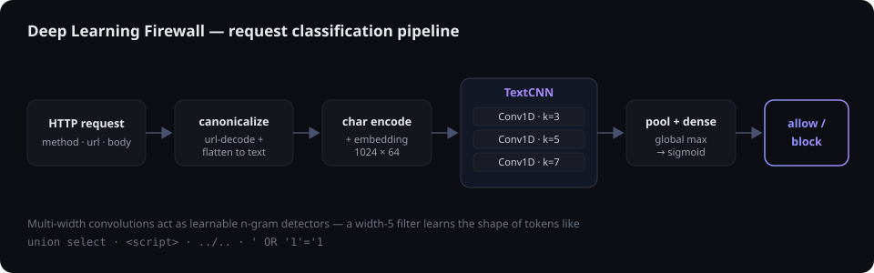
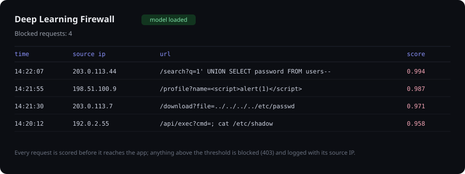

<div align="center">

# 🛡️ Deep Learning Firewall

**A character-level neural web application firewall.**
Reads raw HTTP requests character-by-character with a TextCNN and blocks
SQL injection, XSS, path traversal, and command injection — without signatures.

[](https://www.python.org/)
[](https://www.tensorflow.org/)
[](LICENSE)

</div>

---

Signature-based firewalls block only what they already know. This project learns
the *shape* of a malicious request instead: it flattens each HTTP request to text,
reads it one character at a time, and a convolutional network decides whether it's
an attack — catching obfuscated and previously-unseen payloads.

<p align="center"></p>

## Why a character-level TextCNN

- **Characters, not tokens.** Attacks hide between word boundaries
  (`uni/**/on sel/**/ect`, `%2e%2e%2f`). Character input sees through that; a
  word tokenizer wouldn't.
- **Multi-width convolutions** act as learnable n-gram detectors. A width-3 filter
  can fire on `../`, a width-5 on `<scri`, a width-7 on `union s`. Running several
  widths in parallel captures attack tokens of different lengths in a single pass.
- **Global max-pooling** keeps the strongest evidence anywhere in the request, so
  the model is position-independent — the payload can be in the path, the query, or
  the body.

```
Embedding(vocab, 64) → [Conv1D(k) → GlobalMaxPool for k in 3,5,7] → concat
                     → Dropout → Dense(64) → Dropout → Dense(1, sigmoid)
```

## Install

```bash
python -m venv .venv && source .venv/bin/activate   # Windows: .venv\Scripts\activate
pip install -r requirements.txt
```

## Train

On the **CSIC 2010** HTTP dataset (place `normalTrafficTraining.txt`,
`normalTrafficTest.txt`, `anomalousTrafficTest.txt` under `data/csic2010/`):

```bash
python -m dlfw.train --data data/csic2010
```

Or a quick run on generated data (no download needed):

```bash
python -m dlfw.train --synthetic
python -m dlfw.evaluate --synthetic
```

Training uses a stratified split, class weights for imbalance, early stopping on
validation AUC, and reports precision / recall / F1 / AUC on a held-out set. The
model and its vocabulary are saved to `artifacts/`.

## Run the firewall

```bash
python waf/app.py        # http://localhost:5000
```

The Flask gateway scores every request and blocks the malicious ones, logging
each with its source IP on a live dashboard:

<p align="center"></p>

```bash
# score an arbitrary request
curl -s localhost:5000/inspect -H 'Content-Type: application/json' \
  -d '{"method":"GET","url":"/p?id=1'\'' OR '\''1'\''='\''1"}'
# -> {"malicious": true, "score": 0.99}
```

`/proxy/<path>` demonstrates the middleware position a real reverse proxy would
front: allowed requests pass, malicious ones get a `403`.

## Use it in code

```python
from dlfw.detector import FirewallDetector
from dlfw.data import request_to_text

det = FirewallDetector.load()
det.is_malicious(request_to_text("GET", "/search?q=<script>alert(1)</script>"))  # True
```

## Project layout

```
dlfw/
├── config.py       hyperparameters + paths
├── encoding.py     char vocabulary (encode / pad / save / load)
├── data.py         CSIC 2010 parser + request canonicalization + synthetic data
├── model.py        the TextCNN (Keras)
├── train.py        training entrypoint
├── evaluate.py     precision / recall / F1 / confusion matrix
└── detector.py     load-once inference wrapper
waf/app.py          Flask WAF gateway + dashboard
tests/              pytest (data + encoding run without TensorFlow)
```

## Dataset

**CSIC 2010** (Spanish Research National Council) — ~36,000 normal and 25,000+
anomalous HTTP requests covering SQL injection, buffer overflow, XSS, CRLF, and
information-gathering attacks. Not redistributed here; download it and point
`--data` at the folder.

## License

MIT — see [LICENSE](LICENSE).
